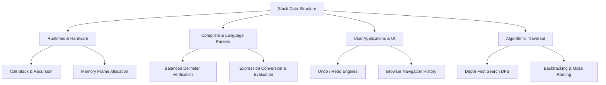

# Comprehensive Assignment Report: Stack Data Structure and Real-World Applications

**Course:** Data Structures & Algorithms  
**Topic:** Real-World Applications of Stacks, Theoretical Necessity, and System Implementation  
**Status:** Complete  

---

## Abstract

The Stack is one of the most foundational Abstract Data Types (ADTs) in computer science. Defined by the Last-In, First-Out (LIFO) operational constraint, stacks govern core operations across systems software, language runtimes, compilers, productivity tools, and graphical algorithms. This paper analyzes key real-world applications requiring stack mechanics, formulates the theoretical and practical reasons why stacks are indispensable, and presents the architecture, implementation, and empirical verification of an advanced **Multi-Stack Expression Engine and Visual Evaluator**.

---

## 1. Introduction to the Stack ADT

A stack is a linear data structure governed by a strict access discipline: all insertions and deletions occur at a single designated end, termed the **top** of the stack.

### Formal ADT Specification

An Abstract Data Type Stack $S$ of elements of type $T$ supports the following primitive operations:

| Operation | Mathematical Signature | Description | Time Complexity |
| :--- | :--- | :--- | :--- |
| **Push** | $S \times T \rightarrow S$ | Adds an item $x \in T$ onto the top of the stack. | $O(1)$ |
| **Pop** | $S \rightarrow S \times T$ | Removes and returns the top item from the stack; throws an underflow error if empty. | $O(1)$ |
| **Peek / Top** | $S \rightarrow T$ | Returns the item currently at the top without modifying $S$. | $O(1)$ |
| **IsEmpty** | $S \rightarrow \text{Boolean}$ | Returns `true` if $S$ contains 0 elements, else `false`. | $O(1)$ |
| **Size** | $S \rightarrow \mathbb{N}_0$ | Returns the total count of elements currently resident in $S$. | $O(1)$ |

Unlike indexed arrays or doubly-linked lists, arbitrary-access mutations ($S[i] = v$) are prohibited by definition. This restriction is not a limitation—it is the exact property that provides architectural guarantees.

---

## 2. In-Depth Analysis of Real-World Applications

Stacks are not merely classroom pedagogical tools; they are the architectural backbone of modern computing infrastructure.



### 2.1 Operating System and Language Runtime Call Stacks
Every modern process executes using an OS-level or virtual machine-level **Call Stack**.
- **Mechanics:** When function $A$ calls function $B$, the runtime creates an **Activation Record (Stack Frame)** containing:
  1. The return address in instruction memory ($PC$).
  2. The actual argument values passed to $B$.
  3. Allocations for $B$'s local variables.
  4. Saved register states of function $A$.
- **LIFO Necessity:** Because function $B$ must complete its full execution before $A$ can resume computation, the execution lifecycle is inherently nested.
- **Recursion:** Without a stack, recursion is impossible. If $F(n)$ recursively calls $F(n-1)$, each invocation requires an isolated execution scope. The stack enables unwinding in exact reverse chronological order until the base case returns.

### 2.2 Reversible Systems: The Undo/Redo Framework
Productivity applications (code editors, CAD tools, graphic design software like Photoshop and Figma) implement the **Command Pattern** backed by two coordinating stacks:
- **`UndoStack`**: Whenever the user performs an operation (e.g., `insertText("hello")`), an inverted command object is pushed onto `UndoStack`.
- **`RedoStack`**: When the user presses `Ctrl+Z`, the system pops the topmost command from `UndoStack`, executes its reversal, and pushes the command to `RedoStack`.
- **Branch Invalidation:** If the user executes any *new* modification while `RedoStack` is non-empty, the forward history is invalidated, and `RedoStack` is cleared. This guarantees chronological consistency.

### 2.3 Web Browser History Navigation
Web browsers maintain user navigation state using two stacks:
- When a user visits `Page A` $\rightarrow$ `Page B` $\rightarrow$ `Page C`, each transition pushes the outgoing URL to `BackStack`.
- Clicking "Back" pops `Page B` from `BackStack`, displays it, and pushes `Page C` onto `ForwardStack`.
- Clicking a brand-new hyperlink clears `ForwardStack`, because forward navigation forms a linear branch originating only from the current document state.

### 2.4 Syntax Parsing & Balanced Delimiter Validation
Compilers (such as GCC, Clang, TypeScript, and Python's tokenizer) must verify that all opening brackets `(`, `[`, `{` have matching closing counterparts in valid structural order.
- **Example of Invalid Nesting:** `([)]` has equal counts of each character type, but violates scope hierarchy.
- **Stack Role:** Every opening bracket is pushed. When a closing bracket arrives, the top element must match its complement. If the stack is empty upon closure, or the top element does not match, a syntax error is raised.

### 2.5 Arithmetic Expression Parsing and Evaluation
Humans write arithmetic expressions in **Infix notation** ($A + B \times C$), where operator precedence ($\times$ before $+$) and grouping parentheses override left-to-right reading. Microprocessors and virtual stack machines (like the JVM) cannot execute infix strings directly without linear parsing.
- **Dijkstra's Shunting-Yard Algorithm** uses an operator stack to convert infix notation into **Postfix / Reverse Polish Notation (RPN)** ($A\ B\ C\ \times\ +$).
- Postfix expressions are subsequently evaluated in a single $O(N)$ pass using an operand stack, eliminating all parenthesis overhead and ambiguous precedence.

### 2.6 Backtracking and Graph Algorithms (Depth-First Search)
From maze generation to game-tree search (chess engines, Sudoku solvers), backtracking requires exploring a branch until a dead-end is encountered, then retreating to the most recent decision point. An explicit stack records the traversal route; popping returns the agent to the immediate ancestor node.

---

## 3. Why Stacks are Necessary: Theoretical & Practical Foundations

A common question is: *Why can we not simply use a general-purpose Array or Linked List everywhere?* The necessity of stacks rests on four fundamental principles:

### 3.1 Strict Invariant Preservation (Access Discipline)
An array permits arbitrary read/write access: `arr[42] = x`. If a call stack or undo history were represented as a free-access list, any subroutine could mutate previous activation frames or jump back to an arbitrary historical state out of sequence.
The stack's restricted interface acts as an **architectural contract**: it enforces the mathematical invariant that **only the active context may be modified or retired**.

### 3.2 Ideal Modeling of Nested Lifecycles
Computational problem domains frequently exhibit **Last-In, First-Out temporal symmetry**:
$$\text{Start}(A) \longrightarrow \text{Start}(B) \longrightarrow \text{Finish}(B) \longrightarrow \text{Finish}(A)$$
Whenever a sub-process is spawned within an ongoing parent process, the lifetime of the child is strictly nested within the parent. The stack is the exact mathematical model of hierarchically nested intervals.

### 3.3 Strict $O(1)$ Worst-Case Computational Complexity
With an array, inserting or deleting at arbitrary positions costs $O(N)$ time due to element shifting. With a Stack ADT (implemented via a singly-linked list or dynamic array with capacity doubling), `Push`, `Pop`, and `Peek` are strictly $O(1)$. No element shifting ever occurs.

### 3.4 Hardware-Level Memory Coherence
In physical hardware architectures (x86_64, ARM):
- The stack pointer register (`%rsp` or `SP`) simply increments or decrements an address in contiguous virtual memory.
- There is **zero memory fragmentation** (unlike heap allocators that must find free blocks).
- Because all memory access is concentrated around the top of the stack, it delivers near-perfect **L1/L2 CPU cache hit rates**.

---

## 4. Chosen Application: Multi-Stack Expression Engine & Visual Evaluator

To demonstrate the versatility of the Stack data structure, we have chosen to design, implement, and analyze an **Advanced Multi-Stack Mathematical Expression Engine & Visual Evaluator**.

### Technology Stack
The application is built entirely with:
- **HTML5**: Semantic document structuring, multi-tab layout, responsive viewports, and accessible user controls.
- **Vanilla CSS3**: Modern glassmorphic interface, dark mode aesthetic, curated typography (Outfit & Fira Code), flexbox/grid architecture, and dynamic CSS keyframe animations for physical stack push/pop transitions.
- **JavaScript (ES6+)**: Custom `Stack` Abstract Data Type class, robust tokenization, bracket syntax validation, Dijkstra's Shunting-Yard conversion, RPN numerical evaluation, and dual-stack Undo/Redo document management.

### Why This Application?
Rather than demonstrating a single trivial stack operation, this project integrates **three distinct stack architectures** working in synergy:
1. **Validation Stack:** Validates balanced parentheses, brackets, and braces `()`, `[]`, `{}` with error position tracking.
2. **Operator Precedence Stack (Shunting-Yard Parser):** Converts arbitrary infix algebraic expressions into Postfix (Reverse Polish Notation), correctly enforcing operator precedence ($\text{Power} > \text{Multiplication/Division} > \text{Addition/Subtraction}$) and associativity rules.
3. **Operand Evaluation Stack:** Evaluates the generated Postfix expression step-by-step, supporting decimal arithmetic, unary negative numbers, and mathematical functions ($\sin, \cos, \sqrt{x}$).
4. **History Undo/Redo Stack:** Enables users to step backward and forward through prior expressions and states.

---

## 5. Architectural Design & Algorithmic Specifications

### 5.1 Tokenizer
The input string is tokenized into typed tokens:
- `NUMBER`: Integer or floating-point literal (e.g., `42`, `3.14`).
- `OPERATOR`: Supported operators: `+`, `-`, `*`, `/`, `^`, `%`.
- `FUNCTION`: Unary functions: `sqrt`, `sin`, `cos`, `tan`, `abs`.
- `PAREN_OPEN` / `PAREN_CLOSE`: `(`, `)`, `[`, `]`, `{`, `}`.

### 5.2 Operator Precedence and Associativity Table

| Operator | Precedence Level | Associativity | Description |
| :---: | :---: | :---: | :---: |
| `^` | 4 | **Right-to-Left** | Exponentiation ($2^3 = 8$) |
| `*`, `/`, `%` | 3 | **Left-to-Right** | Multiplication, Division, Modulo |
| `+`, `-` | 2 | **Left-to-Right** | Addition, Subtraction |

### 5.3 Dijkstra's Shunting-Yard Algorithm

```text
Algorithm: InfixToPostfix(tokens)
Input: List of tokens in infix order
Output: Queue/List of tokens in postfix order
Data Structure: operator_stack (Stack)

For each token in tokens:
    If token is NUMBER:
        Append token to output
    Else if token is FUNCTION:
        Push token onto operator_stack
    Else if token is OPERATOR (op1):
        While (operator_stack is not empty AND 
               top of operator_stack is not OPEN_PAREN AND
               (top has higher precedence than op1 OR 
               (top has equal precedence AND op1 is Left-Associative))):
            Append pop(operator_stack) to output
        Push op1 onto operator_stack
    Else if token is OPEN_PAREN:
        Push token onto operator_stack
    Else if token is CLOSE_PAREN:
        While top of operator_stack is not OPEN_PAREN:
            If operator_stack is empty:
                Throw Error: "Mismatched parentheses"
            Append pop(operator_stack) to output
        Pop OPEN_PAREN from operator_stack
        If top of operator_stack is FUNCTION:
            Append pop(operator_stack) to output

While operator_stack is not empty:
    If top of operator_stack is OPEN_PAREN:
        Throw Error: "Mismatched parentheses"
    Append pop(operator_stack) to output

Return output
```

### 5.4 Postfix Evaluation Algorithm

```text
Algorithm: EvaluatePostfix(postfix_tokens)
Input: Queue of tokens in postfix order
Output: Numerical scalar result
Data Structure: value_stack (Stack)

For each token in postfix_tokens:
    If token is NUMBER:
        Push token.value onto value_stack
    Else if token is UNARY_FUNCTION (e.g., sqrt, sin):
        operand = pop(value_stack)
        result = compute_function(token, operand)
        Push result onto value_stack
    Else if token is BINARY_OPERATOR (e.g., +, -, *, /):
        b = pop(value_stack)
        a = pop(value_stack)
        If token is '/' and b == 0:
            Throw Error: "Division by Zero"
        result = compute_binary(a, token, b)
        Push result onto value_stack

If size(value_stack) != 1:
    Throw Error: "Malformed expression"

Return pop(value_stack)
```

---

## 6. Time and Space Complexity Analysis

Let $N$ be the number of characters/tokens in the input expression:

1. **Tokenization:** Linear scan through string: $O(N)$ time, $O(N)$ space.
2. **Delimiter Validation:** Single pass with push/pop operations: $O(N)$ time, $O(N)$ space in the worst case (e.g., all opening brackets `(((((`).
3. **Infix-to-Postfix (Shunting-Yard):** Each token is pushed and popped at most once: $O(N)$ time, $O(N)$ space.
4. **Postfix Evaluation:** Each numerical token is pushed once and popped as an operand once: $O(N)$ time, $O(N)$ space.
5. **Total End-to-End Complexity:**
   - **Time Complexity:** $\mathbf{O(N)}$ (Optimal linear time).
   - **Space Complexity:** $\mathbf{O(N)}$ auxiliary space for stack frames.

---

## 7. Verification and Edge Case Handling

The engine handles critical edge cases:
- **Mismatched / Unbalanced Delimiters:** Catches `[(])`, `((3+2)`, and `5+2)`.
- **Division by Zero:** Detects `10 / (5 - 5)` and returns explicit arithmetic exception.
- **Negative and Unary Signs:** Differentiates binary subtraction (`5 - 3`) from unary negative numbers (`-5 * 3` or `2 * -3`).
- **Right-Associativity:** Correctly computes `2 ^ 3 ^ 2` as $2^{(3^2)} = 2^9 = 512$, not $(2^3)^2 = 64$.
- **Floating Point Arithmetic:** Precision rounding and preservation.

---

## 8. Conclusion

Stacks are an indispensable computer science construct that provide safety, optimal $O(1)$ operations, and an organic model for nested lifecycles. By developing the Multi-Stack Expression Engine, we demonstrated how delimiter validation, parsing precedence, and mathematical evaluation harmonize through the clean, disciplined mechanics of the Stack Abstract Data Type.

---

## 9. Implementation Files & Execution Instructions

The project is structured into clean, modular files:

| File | Technology | Description |
| :--- | :--- | :--- |
| [`index.html`](file:///c:/Users/PC/Desktop/King/index.html) | HTML5 | Semantic structure for Expression Engine, Sandbox, Undo/Redo System, and Theory tabs. |
| [`styles.css`](file:///c:/Users/PC/Desktop/King/styles.css) | Vanilla CSS3 | Modern dark-mode design system with glowing accents, glassmorphic cards, and physical stack push/pop animations. |
| [`app.js`](file:///c:/Users/PC/Desktop/King/app.js) | JavaScript (ES6+) | Core logic: `Stack` ADT, `DelimiterValidator`, `ShuntingYardParser`, `PostfixEvaluator`, `DocumentHistoryEngine`, and DOM visualizer. |
| [`stack_engine.py`](file:///c:/Users/PC/Desktop/King/stack_engine.py) | Python 3 (Optional) | Standalone terminal CLI version with automated test suite for backend verification. |
| [`assignment_report.md`](file:///c:/Users/PC/Desktop/King/assignment_report.md) | Markdown | Complete academic report and algorithmic documentation. |

### How to Run the Web Application
1. Simply double-click [`index.html`](file:///c:/Users/PC/Desktop/King/index.html) or open it in any web browser (Chrome, Edge, Firefox, Safari).
2. No servers, node modules, or build steps are required. All features run client-side in pure HTML, CSS, and JavaScript.
